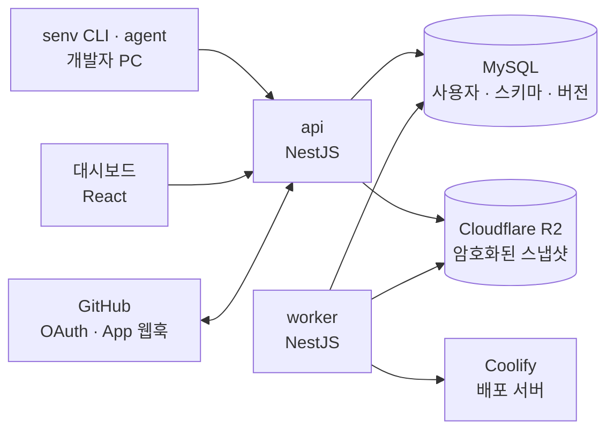

# senv · Stream Env Control

Stream 서버·앱·웹의 환경변수를 한곳에 암호화해 두고, 개발자 PC와 배포 서버(Coolify)로 나눠 주는 내부 도구다.
개발자는 CLI 한 줄로 값을 받아 실행하고, 관리자는 대시보드에서 값을 고쳐 게시하면 배포 서버까지 반영된다.

- **CLI** `senv`: 로그인, 값 받기(`.env` 없이 바로 실행하거나 파일로 쓰기), 값 바꾸기, 점검
- **대시보드**: 키 × 환경 매트릭스, 게시·버전 기록·되돌리기, 키 스키마, 배포 대상 연동
- **서버**: 값은 Cloudflare R2에 버전별로 암호화해 두고, 권한 확인과 복호화는 서버만 한다

## 해결한 문제

| 문제 | senv에서는 |
| --- | --- |
| 환경변수가 Slack DM, Notion, 각자 노트북의 `.env`에 흩어져 어느 값이 최신인지 모른다 | 모든 값이 서버 한곳에 있다. 게시할 때마다 새 버전이 생기고, 버전마다 게시한 사람과 메시지가 남는다. 지난 버전과 비교하고 되돌릴 수 있다 |
| 서버·앱·웹 × local·development·production 조합이 많아 새 키를 더하면 일부 환경에서 빠진다 | 대시보드 매트릭스가 빈 칸을 "누락"으로 보여 주고, 필수 키가 빠지면 게시를 막는다. GitHub 저장소의 `.env.example`을 연결해 두면 코드에 새 키가 생길 때 키 스키마에 자동으로 등록된다 |
| 새로 온 개발자가 동료에게 값을 하나씩 물어봐야 로컬 환경을 맞춘다 | `senv login` 후 `senv run -- pnpm dev` 한 줄이면 된다. `senv agent`를 켜 두면 local 값이 게시될 때 `.env.local`이 저절로 바뀐다 |
| Coolify에 값을 손으로 붙여넣다 오타나 누락이 배포 장애로 이어진다 | 게시하면 매핑된 Coolify 앱에 값이 반영되고 필요하면 재시작·재배포까지 한다. Coolify 화면에서 직접 바꾼 값은 드리프트로 잡아 알려 준다 |
| 시크릿이 앱·웹 번들에 들어갈 수 있다 | `VITE_`, `EXPO_PUBLIC_`처럼 번들에 들어가는 이름의 키가 secret이면 `pull`·`run`이 멈춘다 |
| 값 파일이 실수로 커밋된다 | `senv run`은 파일을 남기지 않는다. 파일로 받을 때는 출력 파일이 `.gitignore`에 없으면 멈추고(`--force`로만 넘어간다), 권한 600으로 쓴다 |

## 구조



- **봉투 암호화**: 스냅샷마다 새 데이터 키(AES-256-GCM)로 암호화하고, 데이터 키는 마스터 키(KEK)로 감싸 함께 저장한다. DB가 없어도 R2 객체와 KEK만 있으면 값을 되살릴 수 있다.
- **로그인**: GitHub OAuth로 로그인하고 지정한 GitHub org의 멤버만 들어온다. CLI는 브라우저 디바이스 로그인을 쓰고 토큰은 OS 키체인에 둔다.
- **배포 대상 제공자**: 인프라별 코드는 `packages/target-*`에만 있다. 지금은 Coolify 하나이고, 다른 인프라는 같은 인터페이스를 구현한 패키지를 더해 붙인다.
- **작업 큐**: Redis 없이 MySQL `jobs` 테이블(`SKIP LOCKED`)로 배포 반영을 재시도한다.

## 기술 스택

| 영역 | 사용 기술 |
| --- | --- |
| 언어·런타임 | TypeScript 6, Node.js 24 (CLI는 22 이상) |
| 모노레포 | pnpm 10 workspaces, Turborepo 2, Biome 2 (린트·포맷) |
| 서버 | NestJS 12 (ESM, Express), Prisma 7 + MySQL 8, Zod 4, @nestjs/swagger, AWS SDK S3 (Cloudflare R2), Node.js `crypto` |
| 대시보드 | React 19, Vite 8, TanStack Router · Query, Primer React (GitHub 디자인 시스템, 다크 모드) |
| CLI | commander, @clack/prompts, @napi-rs/keyring (OS 키체인), tsup |
| API 클라이언트 | 서버가 내보낸 `openapi.json` → openapi-typescript + openapi-fetch |
| 연동 | GitHub OAuth (로그인·org 멤버십), GitHub App (`.env.example` 웹훅), Coolify v4 API |
| 테스트 | Vitest 5, Testcontainers (MySQL), supertest, Testing Library, Playwright |
| CI·배포 | GitHub Actions, Docker (멀티 스테이지), Coolify Docker Compose, GitHub Packages (CLI) |

## 저장소 구조

```text
apps/
  server/            NestJS API·worker, Prisma 스키마와 마이그레이션, openapi.json
  dashboard/         React 대시보드 (src/mock: 서버 없이 도는 목업 모드)
  cli/               senv CLI (@billilge/senv)
packages/
  core/              dotenv·properties 파서, 키 스키마 검증, 공유 참조, diff, 노출 검사, 배포 대상 인터페이스
  api-client/        openapi.json에서 만든 타입 안전 클라이언트
  target-coolify/    Coolify 배포 대상 제공자
  target-testkit/    제공자 계약 테스트와 메모리 제공자
  config/            공유 tsconfig
e2e/                 실제 서버로 도는 CLI 흐름, 브라우저 E2E
docs/plans/          기능별 설계 문서
PRD.md               요구사항, 결정 기록(14장), 구현 현황(15장)
```

## 실행하기

### 준비

- Node.js 24 (`.nvmrc`), pnpm 10 (`corepack enable`)
- Docker: 통합 테스트(Testcontainers)와 로컬 MySQL에 쓴다

```sh
git clone https://github.com/billilge/senv.git
cd senv
corepack enable
pnpm install
```

### 화면만 보기 (목업 모드)

서버·DB·GitHub 없이 브라우저 안의 가짜 API로 모든 화면을 볼 수 있다.

```sh
pnpm --filter @senv/dashboard dev:mock
```

http://localhost:5173 을 연다. 오른쪽 아래 도구로 관리자·멤버·승인 대기 역할을 바꾸거나 데이터를 처음 상태로 되돌린다.

### 서버 띄우기

MySQL 8, 로컬용 GitHub OAuth App(콜백 `http://localhost:3000/auth/github/callback`)이 필요하다. 값을 게시하려면 S3 호환 저장소(R2, MinIO 등)도 있어야 한다.

```sh
# MySQL (예시. apps/server/.env.example의 DATABASE_URL과 맞춰 두었다)
docker run -d --name senv-mysql -p 3306:3306 \
  -e MYSQL_ROOT_PASSWORD=root -e MYSQL_DATABASE=stream_env \
  -e MYSQL_USER=stream_env -e MYSQL_PASSWORD=change-me mysql:8.4

# 환경변수: SENV_KEK, SESSION_SECRET, GITHUB_CLIENT_ID/SECRET, GITHUB_ORG(내가 속한 org),
# SENV_BOOTSTRAP_ADMINS(내 GitHub 사용자명) 등을 채운다. 각 값의 설명은 파일 주석에 있다
cp apps/server/.env.example apps/server/.env

# 서버·대시보드·CLI 빌드 (Prisma 클라이언트 생성 포함)
pnpm build

cd apps/server
set -a && source .env && set +a   # 서버는 .env 파일을 직접 읽지 않는다
pnpm exec prisma migrate deploy
node dist/main.js                 # http://localhost:3000 (대시보드도 같이 연다)
```

배포 대상 동기화와 만료 기록 정리를 돌리려면 다른 터미널에서 같은 방법으로 환경변수를 읽고 `node dist/worker.js`를 실행한다.

대시보드를 고치면서 보려면 `pnpm --filter @senv/dashboard dev`(5173)를 띄운다. API와 로그인 요청은 3000번 서버로 넘어가므로, 이때는 `APP_URL`과 OAuth 콜백을 `http://localhost:5173`으로 맞춘다.

### CLI 써 보기

```sh
export SENV_API_URL=http://localhost:3000   # 기본은 운영 서버
alias senv="node $(pwd)/apps/cli/dist/cli.js"

senv login
cd ~/work/my-app && senv init
senv run -- pnpm dev
```

팀원이 운영 서버에 붙어 쓰는 방법(GitHub Packages 설치, 명령, 로컬 자동 받기, Spring Boot)은 [apps/cli/README.md](apps/cli/README.md)에 있다.

### 검사

| 명령 | 하는 일 |
| --- | --- |
| `pnpm verify` | Biome, 타입 검사, 빌드, 단위·통합 테스트. 통합 테스트가 Testcontainers로 MySQL을 띄우므로 Docker가 켜져 있어야 한다 |
| `pnpm test:browser` | Playwright 브라우저 E2E (로컬에 설치된 Chrome 사용) |
| `pnpm smoke:docker` | 배포 이미지를 MySQL과 함께 띄워 마이그레이션·헬스체크·대시보드·worker를 확인한다 |

GitHub Actions가 main 푸시와 PR마다 세 가지를 모두 돌린다.

## 배포

- **서버**: Coolify의 Docker Compose 리소스가 `docker-compose.yaml`로 `api`와 `worker`를 띄운다. `api`는 시작할 때 마이그레이션을 적용한다. 환경변수는 [PRD 4.5](PRD.md#45-coolify-배포-구성)와 `apps/server/.env.example`에 정리했다.
- **CLI**: `apps/cli/package.json`의 버전을 올리고 `cli-v<버전>` 태그를 푸시하면 GitHub Actions가 검사한 뒤 GitHub Packages에 올린다.

## 진행 상황

| 단계 | 내용 | 상태 |
| --- | --- | --- |
| M1 | CLI, 대시보드(매트릭스·게시·버전 기록·키 스키마), 봉투 암호화, GitHub 로그인, Coolify 배포 대상 연동·드리프트 감지 | 구현 완료, 운영 준비 중 |
| M1.1 | 로컬 자동 받기 (`senv agent`, 대시보드 "내 로컬 연결") | 구현 완료 |
| M1.2 | `.env.example` 연결 (GitHub App 웹훅으로 새 키 등록) | 구현 완료 |
| M2 | 프로젝트 × 환경 권한, 감사 로그, CI용 서비스 토큰, 개인 덮어쓰기 파일 | 예정 |

자동 테스트는 983개다. 요구사항과 모든 설계 결정은 [PRD.md](PRD.md)에, 기능별 설계는 [docs/plans](docs/plans)에 있다.

## 만든 사람

<a href="https://github.com/tnals0924"></a>

**Sumin Hwang** · [@tnals0924](https://github.com/tnals0924)
