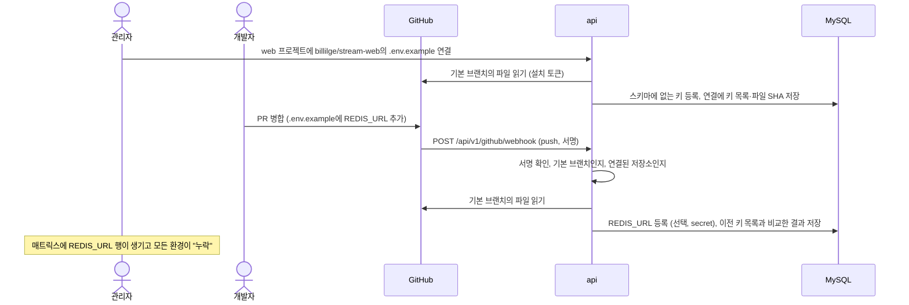

# 계획: 저장소의 `.env.example`을 키 스키마에 반영하기

- 상태: 계획 확정 (2026-10-08). 결정은 PRD 결정 73~77
- 작성: 2026-10-08
- 관련: PRD 5.2(변수 속성), 7.1(화면), 9장(보안), 결정 23·42·44·52

## 1. 요구

> 레포에 `.env.example`이 있다면 그 파일 변경을 감지해서 환경변수 관리에 추가하는 기능

풀어 쓰면 다음과 같다.

1. 서비스 저장소의 `.env.example`에 개발자가 키를 더하면 senv가 그 변경을 스스로 알아챈다.
2. 새 키는 senv 키 스키마에 등록되고, 대시보드 매트릭스에 빈 칸으로 드러나 값을 채울 수 있다.
3. 누구도 키 스키마에 손으로 옮겨 적지 않는다.

노리는 것은 PRD 2.3의 "환경변수 누락·오타로 인한 배포 장애 분기당 0건"이다. 코드가 새 키를 쓰기 시작한 시점(`.env.example` 변경)을 senv가 알아야, 배포 전에 값을 채울 수 있다.

## 2. 어디서 감지하나

| 방법 | 감지 시점 | 필요한 것 | 약점 |
| --- | --- | --- | --- |
| A. CLI: `run`·`pull`·`doctor`가 비교하고 `senv schema sync`로 등록 | 누군가 그 폴더에서 CLI를 실행할 때 | core·CLI만 | 사람이 실행해야 한다. 병합 전 브랜치 내용이 등록될 수 있다 |
| B. 에이전트 자동 등록 | 에이전트를 켠 PC의 연결 폴더에서 파일이 바뀔 때 | CLI 에이전트 | 에이전트를 켠 사람의 연결 폴더만 본다. 병합 전 브랜치 내용도 등록된다 |
| **C. GitHub 저장소 연결** | 기본 브랜치에 푸시될 때 | GitHub App, 웹훅, 새 테이블·화면 | 규모가 크다 (M1.1 정도) |

**C로 정했다.** 병합된 내용(기본 브랜치)만 기준으로 삼고, 누가 CLI를 실행하든 말든 반영된다.

GitHub에서 파일을 읽는 방법은 두 가지를 견줬다.

| 방법 | 반영 시점 | 장점 | 약점 |
| --- | --- | --- | --- |
| **GitHub App + push 웹훅** | 푸시 즉시 | 사람 계정에 묶이지 않는다. 저장소를 골라 설치하고 읽기 전용 권한만 준다 | App 만들기·설치, 웹훅 경로와 서명 검증이 필요하다 |
| fine-grained PAT + worker 주기 확인 | 확인 주기만큼 늦다 | 웹훅이 없다 | 특정 사람 계정에 묶이고 만료를 관리해야 한다 |

**GitHub App + 웹훅으로 정했다.** M4의 "GitHub org 웹훅으로 즉시 권한 회수"도 같은 App에 이벤트만 더해 붙일 수 있다.

지금 로그인용 GitHub OAuth App은 `read:user read:org`만 받아 저장소 내용을 읽지 못한다. 로그인용과 별개로 GitHub App을 하나 더 만든다.

## 3. 전체 구조

### 3.1 용어

- **예시 파일 연결** (`ExampleSource`): (프로젝트, 저장소, 파일 경로) 한 묶음. 프로젝트마다 하나다. 배포 대상 연결·로컬 연결과 헷갈리지 않게 화면에서는 "`.env.example` 연결"이라고 부른다.
- **설치**: GitHub App을 org의 저장소에 설치한 것. 설치한 저장소만 읽을 수 있다.
- 경로는 저장소 루트 기준이다(예: 모노레포면 `apps/web/.env.example`). 파일 이름은 자유라 `.env.sample`도 된다.

### 3.2 무엇을 읽고 무엇을 등록하나

**읽기** (core `parseEnvExample`)

- `KEY=값`, `export KEY=값`, `KEY=` 줄에서 **키 이름만** 꺼낸다. 값은 파서 안에서 버리고 저장·로그·응답 어디에도 남기지 않는다. 예시 파일에 실수로 진짜 값이 들어 있어도 senv로 퍼지지 않게 하려는 것이다.
- 키 바로 위에 빈 줄 없이 붙은 `#` 주석 줄을 설명으로 쓴다. 없으면 같은 줄 뒤의 주석(`PORT=3000 # 서버 포트`)을 쓴다. 스키마 설명 한도인 500자에서 자른다.
- 키 이름 규칙(5.2: 대문자·숫자·밑줄)에 맞지 않거나 `=`가 없는 줄은 건너뛰고 "읽지 못한 줄"로 결과에 남긴다. 한 줄 때문에 나머지를 버리지 않는다.
- 같은 키가 여러 번 나오면 한 번만 센다.

**등록** (core `planExampleImport`)

- 키 스키마에 **없는 키만** 등록한다. 이미 있는 키의 속성(타입, 필수, 설명 등)은 건드리지 않는다. 지금 `KeySchemaService.put`은 주지 않은 속성을 기본값으로 덮으므로 쓰지 않고, 없을 때만 만드는 경로를 따로 둔다.
- 새 키의 속성은 선택(필수 아님), 타입 `string`, 빌드 시점 아님이다. visibility는 프로젝트의 공개 접두사(예: `VITE_`)로 시작하면 `public`, 아니면 `secret`이다. 공개 접두사 키를 secret으로 등록하면 노출 검사(결정 42)에 걸려 `pull`·`run`이 멈추기 때문이다.
- 타입을 예시 값으로 짐작하지 않는다(`DEBUG=1`이 boolean인지 알 수 없다). 필요하면 키 스키마 탭에서 고친다.
- 예시에서 **빠진 키**는 지우지 않고 알리기만 한다. 키 스키마에는 예시에 없는 키(배포 서버에서만 쓰는 값 등)도 있어서, 빠졌다고 지우면 사람이 등록한 키까지 지울 수 있다.
- 값은 등록하지 않는다. 새 키는 모든 환경이 빈 칸이다.

### 3.3 매트릭스에 드러내기

새 키는 선택 키라 게시를 막지 않는다. 그런데 지금 매트릭스는 값이 없는 스키마 키를 필수일 때만 행으로 보여준다(`apps/dashboard/src/project/matrix.tsx`). 그래서 **스키마의 모든 키를 행으로** 보이게 바꾼다. 선택 키의 빈 칸은 이미 노란 "누락"으로(필수는 빨간 "누락") 표시하고 있어서, 새 표시를 만들지 않고 그대로 쓴다. 프로젝트 목록의 누락 칸 수(결정 44)도 같은 기준으로 센다.

## 4. 보안 설계

| 위협 | 대응 |
| --- | --- |
| 웹훅 위조 (아무나 웹훅 경로에 요청) | 받은 본문 바이트로 HMAC-SHA256을 계산해 `X-Hub-Signature-256`과 시간 일정 비교한다. 서명이 없거나 다르면 401이고 아무것도 하지 않는다 |
| 다른 저장소·브랜치의 푸시 | 연결은 GitHub 저장소의 **숫자 id**로 찾는다(저장소 이름이 바뀌어도 따라간다). `ref`가 기본 브랜치일 때만 처리하고 나머지는 무시한다(204) |
| 웹훅 순서 뒤바뀜·누락 | 푸시의 커밋이 아니라 **기본 브랜치의 지금 파일**을 읽는다. 웹훅은 "확인해라" 신호로만 쓴다. 늦게 도착한 옛 웹훅도 같은 결과를 내고, 놓친 웹훅은 다음 푸시나 "지금 확인"에서 따라잡는다 |
| 예시 파일 속 진짜 값 | 파서가 값을 버린다 (3.2) |
| 악의적인 변경이 키를 더함 | 기본 브랜치에 병합된(리뷰를 거친) 내용만 읽는다. 들어오는 것은 선택 키 이름뿐이고, 값이나 기존 키의 속성은 바꿀 수 없다 |
| App 개인 키 유출 | 설치한 저장소의 내용을 읽을 수 있게 된다. App 권한은 Contents·Metadata 읽기 전용으로 두고, 필요한 저장소에만 설치한다. 개인 키는 `api` 컨테이너 환경변수에만 둔다(worker는 쓰지 않는다) |
| 큰 파일·큰 본문 | 예시 파일은 64KB까지 읽고, 넘으면 `too_large`로 남긴다. 웹훅 본문은 웹훅 경로만 5MB까지 받는다(커밋이 많은 푸시는 본문이 수 MB가 된다). 넘으면 413이고 다음 푸시에서 따라잡는다 |

권한은 다음과 같다.

- 연결 만들기·바꾸기·끊기: 관리자 (배포 대상 연결과 같은 수준, 결정 52)
- 연결 상태 보기, 지금 확인: 활성 멤버
- 웹훅: GitHub 서명만 본다 (세션·토큰 없음)

## 5. 변경 범위

### 5.1 core (`packages/core`)

| 함수 | 동작 |
| --- | --- |
| `parseEnvExample(text)` | `{ entries: { key, description }[], skipped: { line, reason }[] }`. 값은 돌려주지 않는다 |
| `planExampleImport(entries, schemaKeys, publicPrefixes)` | 스키마에 없는 키와 등록할 속성 |
| `diffKeyNames(before, after)` | `{ added, removed }`. 이전 예시와 비교해 알리는 데 쓴다 |

### 5.2 서버 (`apps/server`)

**설정**: 아래 세 변수가 모두 있으면 기능이 켜지고, 하나도 없으면 꺼진다. 일부만 있으면 시작할 때 오류를 낸다.

| 변수 | 용도 |
| --- | --- |
| `GITHUB_APP_ID` | App id (JWT의 `iss`) |
| `GITHUB_APP_PRIVATE_KEY` | App 개인 키 PEM. 한 줄로 넣을 수 있게 `\n`도 줄바꿈으로 받는다 |
| `GITHUB_APP_WEBHOOK_SECRET` | 웹훅 서명 비밀 |
| `GITHUB_APP_SLUG` (선택) | 대시보드의 "App 설치" 링크(`https://github.com/apps/<slug>/installations/new`) |

**데이터** (Prisma 마이그레이션 1개)

| 테이블 | 열 |
| --- | --- |
| `example_sources` | id, project_id(유일), installation_id, repo_id, repo_full_name, path(512), last_checked_at, last_result(`ok`·`not_found`·`no_access`·`too_large`·`error`), last_message, last_blob_sha, last_keys(키 이름 목록), last_added, last_removed, last_skipped(읽지 못한 줄), created_by, created_at, updated_at |

`last_added`·`last_removed`는 파일이 마지막으로 **바뀌었을 때** 등록한 키와 빠진 키다. SHA가 같으면 확인 시각만 바꾼다.

**GitHub App 클라이언트** (`GitHubAppClient`. 운영은 HTTP 구현, 테스트는 가짜)

- App JWT(RS256, `node:crypto`, `iat`을 60초 앞당기고 10분 안에 만료) → 설치 토큰(`POST /app/installations/{id}/access_tokens`). 설치 토큰은 만료 1분 전까지 메모리에 둔다.
- `listRepositories()`: `GET /app/installations` 후 설치마다 `GET /installation/repositories`
- `readFile(installationId, repoFullName, path)`: `GET /repos/{owner}/{repo}/contents/{path}`(ref를 주지 않으면 기본 브랜치) → `{ sha, size, text, htmlUrl }` 또는 없음
- 로그인용 GitHub 클라이언트처럼 Octokit 없이 직접 만든다(PRD 15.4). JWT 만들기와 웹훅 서명 검증은 순수 함수라 단위 테스트한다. 실제 GitHub HTTP 호출은 자동 테스트하지 않는다.

**서비스** (`ExampleSourceService`)

- `link(project, { repoId, path }, actor)`: 공유 그룹이면 422, App이 그 저장소에 설치되어 있지 않으면 422, 파일이 없으면 422 `example_not_found`. 저장한 뒤 바로 한 번 확인한다(처음 연결할 때 지금 있는 키를 모두 등록).
- `check(project, actor)`: 파일을 읽고, SHA가 같으면 확인 시각만 바꾼다. 다르면 파싱 → 이전 키와 비교 → 없는 키 등록 → 결과 저장. 같은 연결은 `GET_LOCK`으로 한 번에 하나씩 처리한다.
- `handlePush(event)`: 기본 브랜치 푸시면 `repo_id`가 같은 연결마다 `check`를 돌린다. 웹훅 요청 안에서 바로 처리하고 작업 큐는 쓰지 않는다(파일 하나 읽기라 GitHub의 10초 한도 안에 끝나고, 실패해도 다음 푸시나 "지금 확인"이 같은 결과를 낸다).
- 키 등록: `KeySchemaService`에 "없을 때만 만들기"(`createMany` + `skipDuplicates`)를 더한다. `updated_by`는 연결·지금 확인이면 그 사용자 id, 웹훅이면 `github:<푸시한 사람>`이다.

**API**

| 메서드 | 경로 | 동작 |
| --- | --- | --- |
| GET | `/api/v1/projects/{project}/example-source` | 연결 상태, App이 켜져 있는지, 설치 링크 (멤버) |
| PUT | `/api/v1/projects/{project}/example-source` | 연결·변경 `{ repoId, path }` (관리자) |
| DELETE | `/api/v1/projects/{project}/example-source` | 연결 끊기. 등록된 키는 남는다 (관리자) |
| POST | `/api/v1/projects/{project}/example-source/check` | 지금 확인 (멤버) |
| GET | `/api/v1/github/repositories` | App이 설치된 저장소 목록 (관리자) |
| POST | `/api/v1/github/webhook` | GitHub 웹훅. 인증 대신 서명을 본다. `push`만 처리하고 `ping`은 200, 나머지는 204 |

웹훅도 `/api/v1` 아래에 두므로 결정 23(밖에 두는 경로)은 그대로다. App 설정이 없으면 웹훅·저장소 목록·연결 API는 404 `github_app_disabled`를 돌려준다.

**프로젝트 목록 요약**: 누락 칸을 셀 때 스키마의 모든 키를 넣는다 (3.3).

### 5.3 대시보드 (`apps/dashboard`)

- **키 스키마 탭 위의 "`.env.example` 연결" 상자**
  - 연결이 없으면: 관리자에게 "저장소 연결" 버튼 → 대화상자(저장소 고르기, 경로는 기본 `.env.example`). App 설정이 없거나 설치된 저장소가 없으면 설치 안내와 링크를 보여준다.
  - 연결이 있으면: 저장소·경로(GitHub 파일 링크), 마지막 확인 시각과 결과, 마지막 변경에서 등록한 키와 예시에서 빠진 키, 읽지 못한 줄, "지금 확인"(멤버), "연결 끊기"(관리자)
- **매트릭스**: 스키마의 모든 키를 행으로 보인다 (3.3).
- **목업 모드**: 가짜 저장소 목록과 예시 파일로 같은 흐름을 보여준다. 목업 서버의 목록 요약도 같은 기준으로 센다.
- **가이드**(결정 72): "`.env.example` 연결" 절을 더한다.

### 5.4 CLI (`apps/cli`)

바꾸지 않는다.

## 6. 진행 순서 (TDD, 단계마다 `pnpm verify` 통과 후 커밋)

1. **매트릭스·목록 요약에 선택 스키마 키**: GitHub와 상관없어 먼저 한다. 대시보드 매트릭스, 서버 목록 요약, 목업 서버.
2. **core**: `parseEnvExample`, `planExampleImport`, `diffKeyNames`. 단위 테스트.
3. **서버 키 등록**: 없을 때만 만들기. Testcontainers 통합 테스트.
4. **서버 GitHub App 기반**: 설정(모두 있음·없음·일부만), JWT 서명, 웹훅 서명 검증은 단위 테스트. HTTP 클라이언트(테스트 없음)와 가짜 클라이언트.
5. **서버 예시 연결**: 마이그레이션, `ExampleSourceService`(가짜 GitHub App + Testcontainers). 첫 연결 등록, 변경 없음, 키 추가·빠짐, 기존 키 보존, 공개 접두사, 파일 없음·권한 없음·너무 큼, 공유 그룹 거부, 동시 확인.
6. **서버 API**: 컨트롤러, 웹훅(서명 틀림 401, 기본 브랜치 아님 무시, 처리), 권한(관리자·멤버), 기능 꺼짐 404, OpenAPI와 api-client 갱신.
7. **대시보드**: 연결 상자와 대화상자, 목업 모드. Testing Library 테스트.
8. **문서**: PRD 4.5 환경변수 표, `docker-compose.yaml`의 `api` 환경변수, 가이드, PRD 15장.

크기는 M1.1 로컬 자동 받기와 비슷하다. 대부분 서버이고 CLI는 바뀌지 않는다.

## 7. 운영 준비 (담당자 작업)

- [ ] billilge org Settings → Developer settings → GitHub Apps에서 App 만들기
  - Webhook URL `https://senv.stream.billilge.site/api/v1/github/webhook`, Webhook secret 생성
  - Repository permissions: Contents Read-only, Metadata Read-only. 그 밖의 권한은 주지 않는다
  - Subscribe to events: Push
  - Where can this GitHub App be installed: Only on this account
- [ ] 개인 키(.pem)를 만들어 Coolify `api` 서비스에 `GITHUB_APP_*` 입력
- [ ] `.env.example`이 있는 서비스 저장소에만 설치 (Only select repositories)
- [ ] 실제 GitHub로 한 번 확인: 연결 → 키 등록 → 예시 파일을 바꿔 main에 푸시 → 새 키 등록. 실제 HTTP 클라이언트는 자동 테스트하지 않기 때문이다

## 8. 결정

| # | 질문 | 결정 | 고르지 않은 선택지 |
| --- | --- | --- | --- |
| 1 | 감지 위치 | GitHub 저장소 연결 (기본 브랜치 푸시) | CLI에서 비교하고 `senv schema sync`로 등록, 에이전트 자동 등록 |
| 2 | GitHub 접근 | GitHub App + push 웹훅 | fine-grained PAT + worker 주기 확인 |
| 3 | 새 키의 필수 여부 | 선택으로 등록하고, 매트릭스가 모든 스키마 키를 행으로 보인다 | 필수로 등록 (값을 채우기 전에는 그 환경의 게시·doctor가 막힘) |
| 4 | CLI가 새 키를 찾았을 때 | 해당 없음. 1에서 CLI 감지를 고르지 않았다 (답은 "안내만") | - |
| 5 | 등록 범위 (권장안) | 키 이름과 주석 설명만. 값과 타입은 짐작하지 않는다. 없는 키만 등록하고 빠진 키는 알리기만 한다 | 예시 값을 local 값으로 등록, 빠진 키 자동 삭제 |
| 6 | 권한 (권장안) | 연결은 관리자, 지금 확인은 멤버 | 멤버도 연결 |
| 7 | 읽는 시점 (권장안) | 웹훅은 신호로만 쓰고 기본 브랜치의 지금 파일을 웹훅 요청 안에서 바로 읽는다 | 푸시 커밋 기준으로 읽기, worker 작업 큐 |
| 8 | 단계 (권장안) | M1.1 다음, M2 앞의 M1.2 | M2에 포함, M4 |

선택지에서 고른 것은 1~3이고, 5~8은 권장안으로 정했다.

## 9. 하지 않는 것

- 예시 값 가져오기. 예시 값은 자리 표시라 실제 값으로 쓰면 안 된다.
- 예시에서 빠진 키 자동 삭제.
- 기본 브랜치 밖(PR 브랜치) 확인. PR에서 "production에 REDIS_URL 값이 없다"를 알리는 GitHub Check는 App에 Checks 권한을 더하면 되는 후속 후보다.
- CLI에서 `.env.example` 비교(`senv doctor` 경고 등). 필요해지면 따로 정한다.
- 한 프로젝트에 예시 파일 여러 개, GitHub 밖 저장소(GitLab 등).
